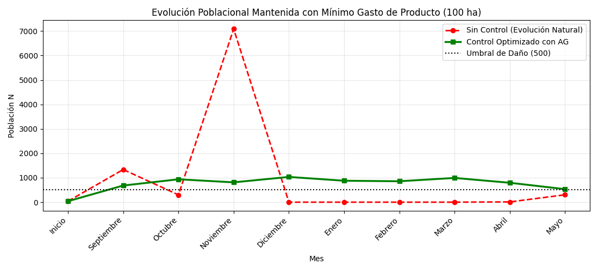

# Optimización del control de la oruga cogollera mediante teoría del caos y algoritmos genéticos

Trabajo de investigación de la materia **Algoritmos Genéticos** de Ingeniería en Sistemas de Información (UTN Facultad Regional Rosario).

📄 **Aceptado en el XIV CoNaIISI 2026** (12 y 13 de noviembre de 2026, UTN Facultad Regional Resistencia)

**Autores:** Bruno Pacienzia, Facundo Morresi, Gonzalo Sandivaras y Enzo Manavella

👉 [Leer el paper (PDF)](paper/Optimizacion_control_oruga_cogollera.pdf)

## De qué se trata

El modelo simula la evolución de la población de la oruga cogollera (*Spodoptera frugiperda*) en el cultivo de maíz entre septiembre y mayo. Usa la ecuación de Ricker y tiene en cuenta la temperatura y la humedad del sur de Santa Fe y el norte de Buenos Aires.

Sobre esa simulación, un algoritmo genético busca la estrategia de control más barata mes a mes. Elige entre dos insecticidas (Spinetoram y Spinosad) y distintas dosis, penaliza repetir el mismo producto en meses seguidos y penaliza que la plaga supere el umbral de daño.

**Parámetros del algoritmo:** población de 80 individuos, 150 generaciones, selección por torneo, crossover de un punto, mutación del 15 % y elitismo.



## Cómo ejecutarlo

```bash
pip install numpy matplotlib
python modelo/caos.py
```

## Estructura

- `modelo/caos.py`: modelo poblacional y algoritmo genético
- `modelo/salida.png`: gráfico de resultados
- `paper/`: artículo presentado en el CoNaIISI 2026
